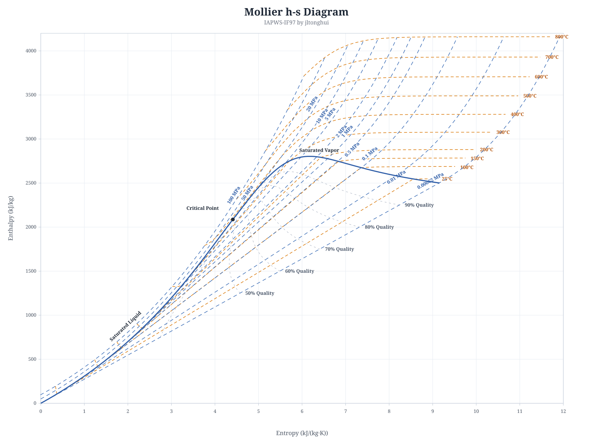

# API and numerical reference

[README](../README.md) · [API](#main-api) · [Units](#units) · [Saturation](#saturation-endpoints) · [Limits](#errors-and-limits) · [Verification](#verification) · [References](#references)

API behavior, numerical limits, and verification commands for `iapws-if97`. See the [README](../README.md) for installation and common workflows. Run verification commands from the repository root.

## Main API

| Function | Input pair | Units |
| --- | --- | --- |
| `solvePT(p, T)` | pressure, temperature | `MPa`, `K` |
| `solvePH(p, h)` | pressure, enthalpy | `MPa`, `kJ/kg` |
| `solvePS(p, s)` | pressure, entropy | `MPa`, `kJ/(kg·K)` |
| `solveHS(h, s)` | enthalpy, entropy | `kJ/kg`, `kJ/(kg·K)` |
| `solveTH(T, h)` | temperature, enthalpy | `K`, `kJ/kg` |
| `solveTS(T, s)` | temperature, entropy | `K`, `kJ/(kg·K)` |
| `solvePx(p, x)` | pressure, vapor quality | `MPa`, dimensionless `[0, 1]` |
| `solveTx(T, x)` | temperature, vapor quality | `K`, dimensionless `[0, 1]` |

All numeric inputs must be finite numbers.

Results retain computed precision without decimal snapping. Backward solvers return computed pressure, enthalpy, and entropy; compare recovered values with numerical tolerances.

Ordinary backward results match enthalpy and entropy inputs within `1e-9 × max(1, |input|)` in the respective units. Iteration tolerances, endpoint resolution, and local fit-gap budgets are separate.

Boundary normalization recomputes the single-phase equation of state (EOS) after adjusting pressure or temperature within tolerance. Region 3 PT inversion preserves input pressure once the relative EOS pressure residual meets `1e-12`.

`solveTH(T, h)` and `solveTS(T, s)` throw `AmbiguousStateError` for multiple solutions in the supported IF97 range. A pair can match compressed liquid and wet steam, or two liquid pressures on a non-monotonic isotherm. Low-temperature TS ambiguity can occur where the thermal expansion coefficient changes sign. Use `solvePT(p, T)` or `solveTx(T, x)` when pressure or vapor quality is known.

At branch endpoints and isotherm extrema, inputs within `1e-9 kJ/kg` for `solveTH` or `1e-12 kJ/(kg·K)` for `solveTS` match that endpoint or extremum. Pressure recovery near an extremum is ill-conditioned.

At Region 1/3 (`623.15 K`), B23, and Region 2/5 (`1073.15 K`), backward solvers resolve fit overlaps using `solvePT`'s boundary ownership: Regions 1, 3, and 2, respectively (Region 2 at B23's `100 MPa` endpoint). Unique roots on either side remain valid.

PH/PS and HS validate candidates from both regions, rechecking B23-normalized states before boundary ownership or a fit-gap fallback. If none succeeds, numerical failures propagate. In confirmed gaps, returned `enthalpy` and `entropy` can differ from inputs by at most the local difference between boundary equations plus roundoff. HS checks both properties at the same boundary coordinate. Both regions must be valid; Region 5 ends at `50 MPa`.

### Unified `solve()`

Use `solve({ mode, ... })` when the input pair is determined at runtime:

```ts
import { solve } from 'iapws-if97';

const state = solve({ mode: 'PT', p: 16, T: 823.15 });
```

Each mode accepts canonical short fields or their long aliases:

| Mode | Short fields | Long aliases |
| --- | --- | --- |
| `PT` | `p`, `T` | `pressure`, `temperature` |
| `PH` | `p`, `h` | `pressure`, `enthalpy` |
| `PS` | `p`, `s` | `pressure`, `entropy` |
| `HS` | `h`, `s` | `enthalpy`, `entropy` |
| `Px` | `p`, `x` | `pressure`, `quality` |
| `Tx` | `T`, `x` | `temperature`, `quality` |
| `TH` | `T`, `h` | `temperature`, `enthalpy` |
| `TS` | `T`, `s` | `temperature`, `entropy` |

```ts
import type { SolveInput } from 'iapws-if97';
import { solve } from 'iapws-if97';

const shortForm: SolveInput = { mode: 'PT', p: 16, T: 823.15 };
const longForm: SolveInput = { mode: 'PT', pressure: 16, temperature: 823.15 };

const a = solve(shortForm);
const b = solve(longForm);
```

You can mix short and long names within one input. If both aliases for the same property are present, their values must match exactly. See the exported `SolveInput` type for accepted combinations.

### Thermodynamics without transport

Use `solveBasic(input)` to skip transport and electromagnetic correlations. It accepts the same eight modes and aliases as `solve()`:

```ts
import { solveBasic } from 'iapws-if97';
import type { BasicProperties } from 'iapws-if97';

const state: BasicProperties = solveBasic({ mode: 'PT', p: 16, T: 823.15 });
const density = 1 / state.specificVolume;
console.log(state.enthalpy, density);
```

It uses `solve()`'s thermodynamic solvers, validation, and ambiguity checks. `BasicProperties` omits `density` and transport fields; full-state solvers compute applicable transport properties.

## Solver return value

`solve()` and the direct input-pair solvers return `SteamState` with thermodynamic and transport properties:

```ts
type SteamState = {
  region: Region;
  pressure: number;
  temperature: number;
  specificVolume: number;
  density: number;
  internalEnergy: number;
  entropy: number;
  enthalpy: number;
  cp: number | null;
  cv: number | null;
  speedOfSound: number | null;
  quality: number | null;
  viscosity: number | null;
  thermalConductivity: number | null;
  surfaceTension: number | null;
  dielectricConstant: number | null;
  ionizationConstant: number | null;
  isobaricExpansion: number | null;
  isothermalCompressibility: number | null;
  saturation?: SaturationEndpoints;
};
```

`SteamState` always uses canonical property names.

- `quality` is `null` for single-phase states; it is only defined on the saturation line.
- In two-phase mixtures (`0 < x < 1`), `cp`, `cv`, `speedOfSound`, `isobaricExpansion`, `isothermalCompressibility`, `viscosity`, `thermalConductivity`, `dielectricConstant`, and `ionizationConstant` are `null`.
- Saturation endpoints (`x = 0` or `x = 1`) still expose single-phase transport properties even though they carry Region 4 metadata.
- Region 4 results include [`saturation`](#saturation-endpoints); single-phase results omit it.
- `solvePT(p, T)` is a single-phase solver. It selects the liquid side of a subcritical isotherm when `p >= saturationPressure(T)`; use `solvePx` or `solveTx` to specify vapor quality.
- `surfaceTension` is only available for Region 4 saturation states below the critical point; otherwise `null`.
- `density` equals `1 / specificVolume` using the returned volume.
- `ionizationConstant` is `null` outside the IAPWS validity range for that correlation.

## Units

- Pressure: `MPa`
- Temperature: `K`
- Specific volume: `m^3/kg`
- Density: `kg/m^3`
- Enthalpy, internal energy: `kJ/kg`
- Entropy, heat capacities: `kJ/(kg·K)`
- Speed of sound: `m/s`
- Quality: dimensionless, `0`–`1` (saturation line only)
- Viscosity: `Pa·s`
- Thermal conductivity: `W/(m·K)`
- Surface tension: `N/m`
- Dielectric constant: dimensionless
- Ionization constant (`pKw`): dimensionless
- Isobaric expansion coefficient: `1/K`
- Isothermal compressibility: `1/MPa`

Any field typed as `number | null` returns `null` when the property is undefined for the given state.

## Advanced imports

The package root exports the main solvers, state and input types, `Region`, and public error classes. Import lower-level helpers from these subpaths:

| Subpath | Exports |
| --- | --- |
| `iapws-if97/transport` | `viscosity`, `thermalConductivity`, `surfaceTension`, `dielectricConstant`, `ionizationConstant` |
| `iapws-if97/regions` | `region1`, `region2`, `region3ByRhoT`, `region5` |
| `iapws-if97/saturation` | `saturationPressure`, `saturationTemperature` |
| `iapws-if97/boundaries` | `boundary23_T_to_P`, `boundary23_P_to_T`, `region3Volume`, `region3SatVolume` |
| `iapws-if97/detect` | `detectRegionPT`, `detectRegionPH`, `detectRegionPS`, `detectRegionHS`, `detectRegionTH`, `detectRegionTS` |

```ts
import { viscosity } from 'iapws-if97/transport';
import { region1 } from 'iapws-if97/regions';
import { saturationTemperature } from 'iapws-if97/saturation';
import { detectRegionPT } from 'iapws-if97/detect';
```

- Region functions return core thermodynamic properties without `density` or transport-property enrichment.
- Region, boundary, and detection helpers require callers to respect equation domains. All six detection helpers return a `Region`, or `-1` for no match or non-finite inputs. `detectRegionTH(T, h)` and `detectRegionTS(T, s)` throw `AmbiguousStateError` for multiple matches, even within one region.
- `thermalConductivity(T, rho)` calculates the base contribution. Pass `cp`, `cv`, `drhodP_T`, and `mu` to include the IAPWS 2011 critical-enhancement term.
- `surfaceTension(T)` is a saturation-line property. `saturationPressure(T)` and `saturationTemperature(p)` expose the mathematical Region 4 boundary and are more permissive at endpoints than `solveTx` and `solvePx`.

## Transport correlation limits

Transport correlations have validity ranges independent of the IF97 thermodynamic envelope. The library may return extrapolated values where noted:

| Property | Implemented behavior |
| --- | --- |
| Viscosity | Uses the IAPWS 2008 dilute-gas and finite-density terms. The near-critical enhancement is omitted, as permitted for industrial use by the release. Throws `IF97Error` for a non-finite or non-positive result. |
| Thermal conductivity | Full `SteamState` calculations include the IAPWS 2011 critical enhancement. The two-argument low-level call does not. Supplied `cp` must be finite and positive. Values above the release's temperature range are extrapolations. |
| Surface tension | Defined for saturation states below the critical point. The low-level helper permits `273.15 K ≤ T ≤ Tc`; values below the triple point `Tt = 273.16 K` are extrapolations. |
| Dielectric constant | Throws `IF97Error` for `T ≤ 228 K`, where the equation is undefined. The IAPWS 1997 release is valid through `873 K`. The low-level helper does not enforce that upper bound, so higher-temperature results are extrapolations. |
| Ionization constant (`pKw`) | Returns `null` outside `273.15 K ≤ T ≤ 1273.15 K`. The release's `1000 MPa` pressure limit describes the correlation, not the state-solver pressure range. |

## Saturation endpoints

The triple and critical points are `Pt = 0.000611657 MPa`, `Tt = 273.16 K`, `Pc = 22.064 MPa`, and `Tc = 647.096 K`.

`solveBasic()` and full-state solvers include both endpoints in `saturation` for every Region 4 result, including `x = 0` and `x = 1`:

```ts
import { solveBasic } from 'iapws-if97';

const state = solveBasic({ mode: 'Px', p: 20, x: 0.5 });
if (state.saturation) {
  const { liquid, vapor } = state.saturation;
  const hfg = vapor.enthalpy - liquid.enthalpy;
  const sfg = vapor.entropy - liquid.entropy;
  const vfg = vapor.specificVolume - liquid.specificVolume;
  console.log({ hfg, sfg, vfg });
}
```

The exported `SaturationEndpoints` type has `pressure`, `temperature`, `liquid`, and `vapor`. The endpoints are independent snapshots at the outer state's pressure and temperature. They retain region `1`, `2`, or `3` and `quality: null`, without `density`, transport fields, or nested `saturation`.

- `solvePx(p, x)` accepts `Pt ≤ p < Pc`; `solveTx(T, x)` accepts `Tt = 273.16 K ≤ T < Tc`. Low-level Region 4 helpers accept a wider endpoint range.
- The triple point is supported: `solvePx(Pt, x)` and `solveTx(Tt, x)` are valid.
- `solveTx(273.15, x)` rejects `0 °C`, which is `0.01 K` below the triple point. Use `saturationPressure(273.15)` for the mathematical Region 4 extrapolation.
- The solvers do not return the exact critical point as a Region 4 state.

Near the critical point, the independent Region 3 and Region 4 fits can lack a stable vapor root at the same pressure and temperature. Saturation solvers throw `IF97Error` if they cannot obtain distinct, stable endpoints, even within the input bounds (for example, `p = 22.0639999 MPa`). See [IF97 section 10.2](https://iapws.org/technical-guidance/release/IF97-Rev.download) for consistency limits between the equations.

Near `623.15 K`, PH/PS prefer Region 4 within the saturation property span, including overlaps with PT-owned Region 2 roots. HS also prefers a valid saturation solution. A PT round trip can therefore change region. Use `solvePx` or `solveTx` to specify quality.

PH/PS use saturation endpoints at the supplied pressure. Targets outside that span retain PT-consistent single-phase roots, including at the saturation/B23 intersection and adjacent floating-point inputs.

The Region 1/2 and Region 3 fits can yield two saturation states near this corner with the same enthalpy and entropy. `solveHS` returns one satisfying its EOS and both inputs within tolerance. Its temperature and quality need not match the source.

Near the triple-point liquid endpoint, HS inversion is ill-conditioned. `solveHS` can recover different temperature and quality values while meeting both input constraints within tolerance.

Single-phase Region 3 inversion also throws `IF97Error` if it cannot construct a stable EOS state on the requested side of the saturation curve.

## Errors and limits

The library throws typed errors:

| Error | Meaning |
| --- | --- |
| `OutOfRangeError` | Input is outside a known supported range; `min` and `max` can depend on the other input |
| `ConvergenceError` | An internal iterative solve failed to converge |
| `AmbiguousStateError` | Multiple physical states match the supplied temperature and either enthalpy or entropy |
| `IF97Error` | Base class; covers numerical state-construction failures and invalid or unsupported inputs without a more specific public error |

Internal subclasses are catchable as `IF97Error`; `constructor.name` is not a public contract. Numerical failure alone does not establish an out-of-range input.

`AmbiguousStateError` extends `IF97Error`. Its `candidates` field contains validated `BasicProperties` states in ascending pressure order; that order does not imply preference. Candidates omit density and transport fields, and Region 4 candidates retain their saturation endpoints.

Numeric inputs to root solvers and transport helpers must be finite. `solvePT(Pc, Tc)`, exact critical Region 4 states, and `solveTH`/`solveTS` inputs within `0.001 K` of `Tc` are rejected because the required derivative properties or inverse solution are singular or ill-conditioned.

## Thermodynamic validity

The thermodynamic solvers follow the piecewise IF97 industrial range:

- `273.15 K ≤ T ≤ 1073.15 K`: pressure up to `100 MPa`.
- `1073.15 K < T ≤ 2273.15 K` (Region 5): pressure up to `50 MPa`.

Transport-property limits are separate; see [Transport correlation limits](#transport-correlation-limits).

## Verification

The test suite covers:

- Official IF97 verification tables (Regions 1–5)
- Official IAPWS backward and supplementary-boundary check values at their printed precision, including all 26 Region 3 `v(p,T)` subregions
- Backward-equation round-trip accuracy
- Temperature-led backward round trips (`TH` and `TS`)
- High-pressure Region 4 regressions
- IAPWS R11-24 ionization-constant verification values
- Coverage thresholds enforced in CI and before packing or publishing
- ASME and GB/T steam-table comparisons against published values

The backward-equation and Region 3 check-value tests compare published outputs before EOS refinement. The absolute tolerance is `0.6 × 10^(floor(log10(abs(expected))) - n + 1)`, where `n` is the printed significant-digit count: nine for IF97 outputs and ten for supplementary releases. These checks do not verify every coefficient against its source table.

These tests exclude the unimplemented SR3-03(2014) saturation boundaries `p3sat(h)` and `p3sat(s)` (Eqs. 10 and 11), and the IF97 B2bc enthalpy equation `h(p)` (Eq. 21).

For a clean local verification run:

```bash
npm ci
npm run typecheck
npm run test:package
node scripts/scan-saturation.mjs
npm run test:coverage
```

`typecheck` checks source and tests without emitting files. `test:package` does a clean build, installs the npm tarball in an isolated consumer, and checks public exports, TypeScript declarations, and source-map references. Negative tests cover broken exports and missing runtime or declaration files. These checks and coverage thresholds run before packing or publishing. Run only the published-table comparisons with:

```bash
npm run test:standards
```

The numerical scans check deterministic samples across the PT domain and saturation curve, including region boundaries and critical neighborhoods:

```bash
npm run build
node scripts/scan-domain.mjs
node scripts/scan-saturation.mjs
```

Each scan writes a JSON report and exits with an error if it finds an unresolved failure. Finite samples do not establish correctness over the continuous domain.

## Integration validation



This Mollier `h-s` diagram was generated with `iapws-if97` as an end-to-end check of the calculation pipeline.

The standards tests check the published tables below. Both suites enforce `maxRelativeError < 5e-4` (less than `0.05%`).

| Reference | Coverage |
| --- | --- |
| *ASME International Steam Tables for Industrial Use*, 3rd ed., Table S-2 | Saturation states at 6 pressures |
| *GB/T 34060-2017*, Table A.3(续), page 55 | Superheated steam at `10 MPa` and 6 temperatures |

See [`tests/standards-asme`](../tests/standards-asme) and [`tests/standards-cn`](../tests/standards-cn) for the source values and per-case comparisons.

## TypeScript

The package ships with generated TypeScript declarations for the root and every public subpath.

```ts
import type { SolveInput, SteamState } from 'iapws-if97';
import { Region, solve } from 'iapws-if97';

const input: SolveInput = { mode: 'PT', p: 3, T: 300 };
const state: SteamState = solve(input);

if (state.region === Region.Region1) {
  console.log('compressed liquid');
}
```

## References

- [IAPWS official website](https://www.iapws.org/)
- [IAPWS R7-97(2012), Industrial Formulation 1997](https://iapws.org/technical-guidance/release/IF97-Rev)
- [IAPWS supplementary releases](https://iapws.org/technical-guidance/release) for `T(p,h)`, `T(p,s)`, `p(h,s)`, Region 3 boundary equations, `Tsat(h,s)`, and `v(p,T)`
- [IAPWS SR4-04(2014), Region 3 `p(h,s)` and Region 4 `Tsat(h,s)`](https://iapws.org/technical-guidance/release/Supp-phs3-2014)
- [IAPWS R12-08, Viscosity of Ordinary Water Substance](https://iapws.org/technical-guidance/release/viscosity)
- [IAPWS R15-11, Thermal Conductivity of Ordinary Water Substance](https://iapws.org/technical-guidance/release/ThCond)
- [IAPWS R8-97, Static Dielectric Constant of Ordinary Water Substance](https://iapws.org/technical-guidance/release/Dielec)
- [IAPWS R1-76(2014), Surface Tension of Ordinary Water Substance](https://iapws.org/technical-guidance/release/Surf-H2O)
- [IAPWS R11-24, Ionization Constant of H2O](https://iapws.org/technical-guidance/release/Ionization)
